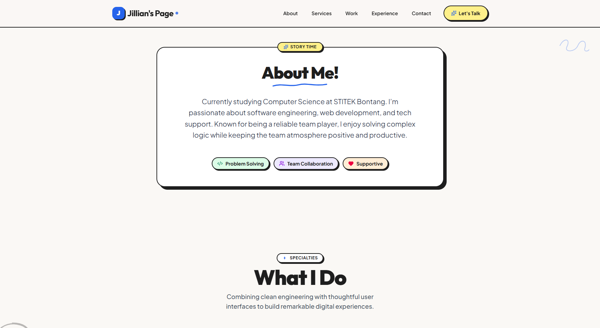
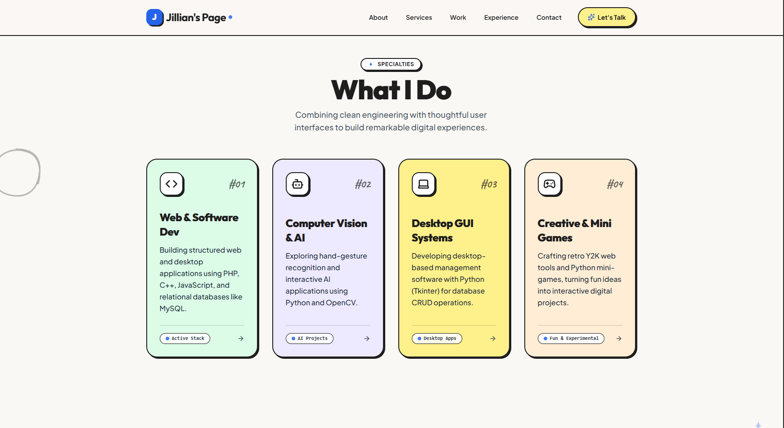
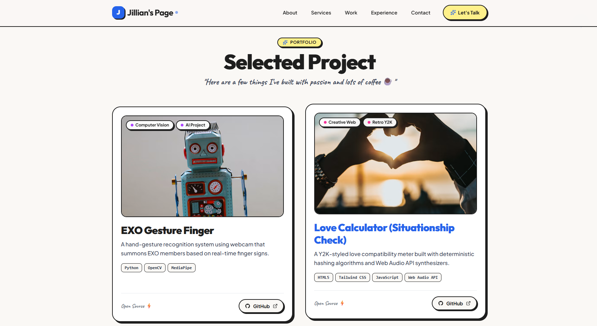
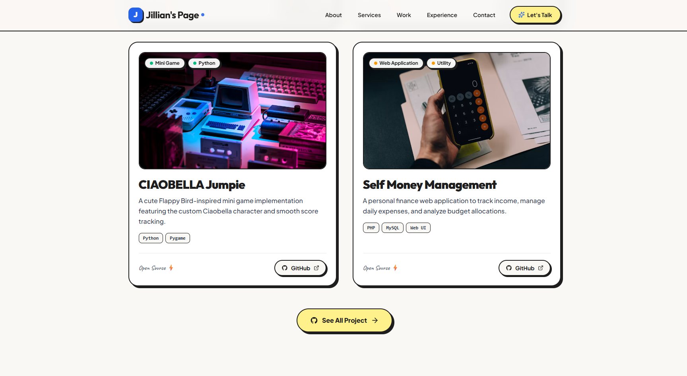
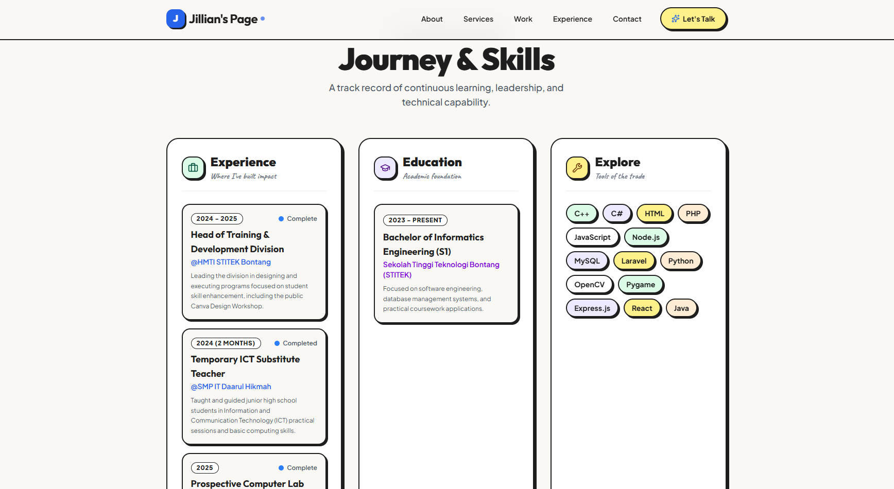

# Jillian's Page - Portofolio Web

---

## Tentang Project

**Jillian's Page** adalah website portofolio pribadi yang dibuat sebagai proyek UTS di mata kuliah Pemrograman Berbasis framework. Website ini dirancang untuk menampilkan profil pribadi, informasi akademik, pengalaman organisasi dan pekerjaan, serta kumpulan proyek yang telah dikerjakan dalam satu halaman portofolio.

---

## Dokumentasi & Teknologi yang Digunakan

### Dokumentasi
1. **Hero Section & Digital Card:** Menyambut pengunjung dengan perkenalan interaktif, lencana status mahasiswa, serta kartu profil digital lengkap dengan status *"Available for hire"*.
   
3. **About Me & Specialties:** Menjelaskan latar belakang akademis sebagai mahasiswa Teknik Informatika di STITEK Bontang serta pilar keahlian utama (*Web & Software Dev, Computer Vision & AI, Desktop GUI, hingga Creative & Mini Games*)[cite: 2, 3].
      
      
5. **Selected Projects Showcase:** Menampilkan galeri proyek unggulan (seperti *EXO Gesture Finger*, *Love Calculator*, *CIAOBELLA Jumpie*, dan *Self Money Management*) lengkap dengan tag teknologi dan tautan langsung ke repositori GitHub[cite: 4, 5].
      
      
7. **Journey & Timeline (Experience & Education):** Menyajikan rekam jejak perjalanan karier dan organisasi (termasuk pengalaman sebagai Head of Training & Development Division di HMTI STITEK Bontang) serta riwayat pendidikan formal.
      
9. **Interactive Exploration & Tech Stack:** Menyediakan daftar lengkap perangkat, bahasa, dan *framework* yang dikuasai secara visual[cite: 6].

### Teknologi yang Digunakan (Tech Stack)
Aplikasi web ini dibangun menggunakan teknologi modern yang ringan tanpa *framework* berat untuk memastikan performa yang cepat dan optimal:
* **HTML5:** Struktur semantik utama dokumen web[cite: 4].
* **Tailwind CSS:** Kerangka kerja CSS untuk mendesain antarmuka yang responsif, rapi, dan estetis[cite: 4].
* **JavaScript (ES6+):** Menghadirkan interaktivitas dinamis pada komponen halaman[cite: 4].
