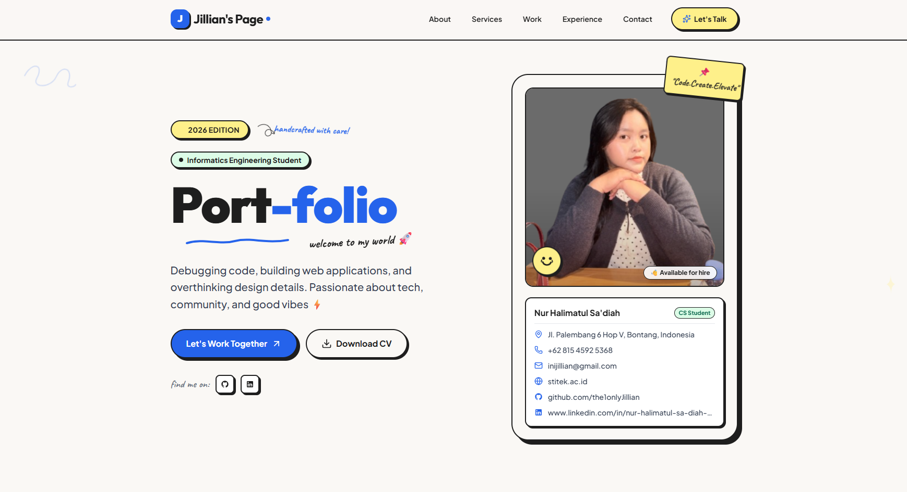

# 🌟 Jillian's Page - Portofolio Web Interaktif

*“Debugging code, building web applications, and overthinking design details. Passionate about tech, community, and good vibes ✨”*

[Tentang Proyek](#-tentang-proyek) · [Fitur & Teknologi](#-fitur-utama--teknologi-yang-digunakan) · [Dokumentasi](#-dokumentasi-proyek) · [Cara Menjalankan](#-cara-menjalankan-proyek)

---

## 📖 Tentang Proyek

**Jillian's Page** adalah website portofolio pribadi bergaya modern dengan sentuhan estetika retro Y2K serta antarmuka yang bersih dan interaktif[cite: 1, 4]. 

Proyek web ini dikembangkan secara khusus untuk memenuhi **Ujian Tengah Semester (UTS) Mata Kuliah Pemrograman Berbasis Framework**. Selain sebagai syarat penilaian akademik, website ini berfungsi sebagai *digital hub* profesional untuk menampilkan profil, rekam jejak akademik, pengalaman organisasi, serta kumpulan portofolio proyek kreatif yang pernah dikerjakan[cite: 1, 3, 4, 6].

---

## ⚡ Fitur Utama & Teknologi yang Digunakan

### 🔹 Fitur Utama
1. **Hero Section & Digital Card:** Menyambut pengunjung dengan perkenalan interaktif, lencana status mahasiswa, serta kartu profil digital lengkap dengan status *"Available for hire"*.
   
3. **About Me & Specialties:** Menjelaskan latar belakang akademis sebagai mahasiswa Teknik Informatika di STITEK Bontang serta pilar keahlian utama (*Web & Software Dev, Computer Vision & AI, Desktop GUI, hingga Creative & Mini Games*)[cite: 2, 3].
4. **Selected Projects Showcase:** Menampilkan galeri proyek unggulan (seperti *EXO Gesture Finger*, *Love Calculator*, *CIAOBELLA Jumpie*, dan *Self Money Management*) lengkap dengan tag teknologi dan tautan langsung ke repositori GitHub[cite: 4, 5].
5. **Journey & Timeline (Experience & Education):** Menyajikan rekam jejak perjalanan karier dan organisasi (termasuk pengalaman sebagai Head of Training & Development Division di HMTI STITEK Bontang) serta riwayat pendidikan formal.
6. **Interactive Exploration & Tech Stack:** Menyediakan daftar lengkap perangkat, bahasa, dan *framework* yang dikuasai secara visual[cite: 6].

### 🛠️ Teknologi yang Digunakan (Tech Stack)
Aplikasi web ini dibangun menggunakan teknologi modern yang ringan tanpa *framework* berat untuk memastikan performa yang cepat dan optimal:
* **HTML5:** Struktur semantik utama dokumen web[cite: 4].
* **Tailwind CSS:** Kerangka kerja CSS untuk mendesain antarmuka yang responsif, rapi, dan estetis[cite: 4].
* **JavaScript (ES6+):** Menghadirkan interaktivitas dinamis pada komponen halaman[cite: 4].
